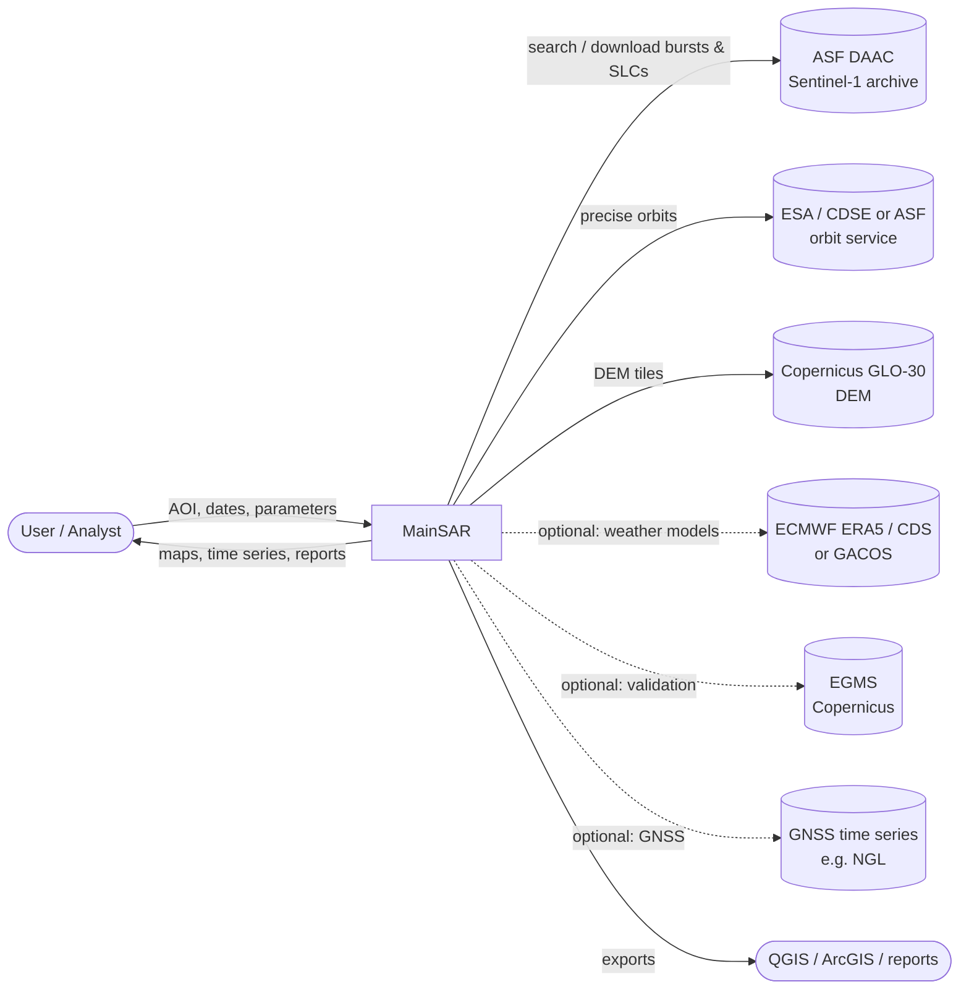

# 01 – Vision & Scope

## 1. Problem statement

Measuring ground deformation (subsidence, uplift, landslides, infrastructure movement) with
Persistent Scatterer InSAR needs a long chain of specialist tools: data search and download,
orbit and DEM retrieval, TOPS coregistration (ISCE2/SNAP), PS processing (StaMPS, MATLAB),
phase unwrapping (SNAPHU), atmospheric correction and geocoding. Each tool has its own install
steps, file formats and parameter files. Running the chain by hand is:

- **slow to set up**, because dependency conflicts are common (ISCE2, StaMPS, SNAPHU, MATLAB/Octave, GDAL),
- **error-prone**, because many manual steps and implicit file conventions are involved,
- **hard to reproduce**, because parameters are spread over several tools and shell histories,
- **inefficient**, because whole Sentinel-1 scenes (~4–8 GB each) are often downloaded and processed
  when the area of interest covers only a few km².

EZ-InSAR (MATLAB GUI around ISCE2 + StaMPS + MintPy) shows that a guided front end helps a lot.
It still inherits the MATLAB dependency and a desktop-only, single-machine execution model.

## 2. Vision

> A reproducible, resource-efficient application. The user defines an **area**, a **time range**
> and a small set of **understandable parameters**, and the application **automatically**
> produces validated, geocoded **ground-displacement results** (mean LOS velocity + displacement
> time series per measurement point), ready for GIS analysis and reporting.

## 3. Goals

| ID   | Goal | Measured by |
|------|------|-------------|
| G-1  | **End-to-end automation.** No manual steps between "define project" and "view results". | Reference scenario runs with zero manual intervention (see [10](10_verification_and_validation.md)) |
| G-2  | **Efficiency.** Download and process only the data the AOI needs. | Downloaded volume per acquisition ≤ burst volume covering the AOI (NFR-EFF-01) |
| G-3  | **Correct, trustworthy results.** | Agreement with an independent reference (EGMS and/or GNSS) within agreed tolerances (NFR-ACC-01) |
| G-4  | **Reproducibility.** | The same project configuration and software version give identical results (NFR-REP-01) |
| G-5  | **Usability for non-experts, full control for experts.** | Presets plus an expert mode; a new user completes the reference scenario from the documentation alone |
| G-6  | **Robustness.** | Interrupted runs resume from the last completed stage (FR-JOB-03) |
| G-7  | **Maintainability.** | Modular processing engines behind a stable interface; automated tests; documented code |

## 4. Scope

### 4.1 In scope (version 1)

- **Users:** university students and researchers with a basic understanding of InSAR.
- **Typical study:** AOIs mostly in **Europe**, **≤ 100 km²**, time spans of a few years (**≤ 5 years**).
- **Operation:** one dedicated Linux machine, used by **one user at a time** through the browser (locally or via SSH tunnel).
- **Installation:** one installer that provides every dependency (ISCE2, Dolphin, SNAPHU, StaMPS, …);
  MATLAB is optional and needs the user's own licence ([14](14_installation_and_operations.md)).
- **Open source:** public git repository under **GPL-3.0**.

- **Sensor:** Sentinel-1 IW SLC from **all units of the constellation: S1A, S1B (archive 2016-04 → 2021-12), S1C and S1D**, handled as one constellation. Single polarisation (VV default).
- **AOI definition:** draw on a map or import a vector file; pick a time range.
- **Data discovery:** list the relative orbits (tracks) that cover the AOI, with acquisition
  counts, gaps and a resource estimate.
- **Data acquisition:** SLC bursts (or full SLC scenes as fallback), precise orbits, DEM, all
  automatic, with caching and resume.
- **Interferometric preprocessing:** single-reference TOPS coregistration of the stack, cropped to the AOI.
- **Multi-temporal analysis with open-source software, covering both main technique families:**
  - **PSInSAR**: PS/DS processing (Dolphin, default) and classic StaMPS PS,
  - **SBAS**: small-baseline time series (MintPy on an ISCE2 interferogram network).
  See [02](02_domain_and_method_analysis.md) §5.
- **Phase unwrapping, time-series inversion, velocity estimation, reference point handling.**
- **Optional corrections:** DEM error (always), atmospheric (spatio-temporal filtering; ERA5/GACOS optional).
- **Geocoding and export:** GeoTIFF, GeoPackage/Shapefile point layers, CSV, KMZ, processing report.
- **Results viewer:** map with measurement points coloured by velocity; click a point to see its time series.
- **Project management:** save, reopen, clone, re-run with changed parameters.
- **Job execution:** background processing with progress, logs, cancel, resume.
- **CLI and configuration file** for batch and headless use, on equal footing with the UI.

### 4.2 Out of scope (version 1) – "Won't this time"

- Sensors other than Sentinel-1 (TerraSAR-X, COSMO-SkyMed, ALOS-2, NISAR). The architecture must
  **allow** adding them later (NFR-MAINT-03).
- Stripmap/EW modes, dual-pol or polarimetric analysis.
- Single-pair DInSAR for co-seismic events (possible later as a separate workflow).
- Full 3D/2D decomposition of multiple geometries (**Should/Could**, see FR-ANA-08; not MVP).
- Multi-user operation (accounts, concurrent sessions, per-user isolation) and multi-tenant SaaS.
- Distributed/remote processing across several machines.
- Automatic interpretation such as hazard classification or alarm thresholds.

## 5. Success criteria for version 1

1. The reference scenario ([10](10_verification_and_validation.md), §4) runs end-to-end without
   manual intervention on the reference hardware.
2. Mean velocities agree with EGMS Ortho/Calibrated (or GNSS) within the tolerance in NFR-ACC-01.
3. A user who has never used the tool completes the reference scenario from the user guide.
4. The run can be reproduced from the exported project configuration.
5. All *Must* requirements pass their acceptance criteria.

## 6. Context diagram

