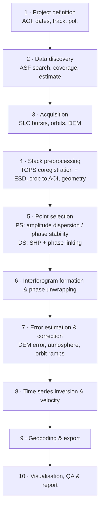

# 02 – Domain & Method Analysis

This document covers the domain knowledge behind the requirements, compares the available processing
approaches, and ends with a **recommendation**. The recommendation drives the architecture (see
[08](08_system_architecture.md)) and needs sign-off from the product owner (Q-01 in
[12](12_open_questions.md)).

---

## 1. InSAR in a nutshell

A SAR satellite records amplitude **and phase** of the backscattered signal. Two acquisitions from
(nearly) the same orbit position at different times form an **interferogram**. Its phase
difference contains:

```
Δφ = φ_defo + φ_topo_err + φ_atmo + φ_orbit + φ_noise  (wrapped to −π … π)
```

| Component | Meaning | How it is handled |
|-----------|---------|-------------------|
| `φ_defo` | Line-of-sight (LOS) displacement: `d_LOS = −λ/(4π) · φ_defo` | The signal we want |
| `φ_topo_err` | Residual topography (DEM error), proportional to the perpendicular baseline | Estimated per point (PS processing) |
| `φ_atmo` | Tropospheric/ionospheric delay; spatially correlated, temporally random | Spatio-temporal filtering, weather models (ERA5), GACOS |
| `φ_orbit` | Orbit errors; negligible with Sentinel-1 precise orbits, residual ramps possible | Precise orbits, optional deramping |
| `φ_noise` | Decorrelation (vegetation, change), thermal noise | Point selection (PS/DS), filtering |

Sentinel-1 C-band: λ ≈ 5.55 cm, so one phase cycle (2π) ≈ 2.8 cm of LOS displacement. Phases are
only known modulo 2π and must be **unwrapped**.

**Sign convention (to be fixed in the application):** positive LOS velocity = movement **towards**
the satellite (uplift / east- or westward depending on geometry), negative = **away** (e.g. subsidence).
This matches EGMS and MintPy. StaMPS reports the same convention in its `v-do` plots after its
internal sign handling. `[VERIFY]` during spike S-3 so all engines export the same convention.

### 1.1 Sentinel-1 IW TOPS specifics

- Interferometric Wide swath (IW): ~250 km swath, **3 sub-swaths (IW1–IW3)**, each split into
  ~9–10 **bursts** per scene (~20 km azimuth extent each). Each burst has a stable global ID
  (**burst ID**, since IPF 3.40, 2021; ESA burst ID map).
- Pixel spacing (SLC): ~2.3 m (slant range) × ~14 m (azimuth); resolution ~5 m × 20 m.
- Repeat cycle: 12 days per satellite; all units fly in the same orbit and share relative orbit numbers, so their
  acquisitions form **one** interferometric stack.
  - **S1A** (since 2014) + **S1B** (Apr 2016 → failure in Dec 2021): **6-day** revisit over Europe until Dec 2021.
  - **S1A only**: 12-day revisit from Dec 2021 until S1C became operational in 2025.
  - **S1C** (launched Dec 2024) restored the 6-day revisit with S1A. **S1D** was launched in Nov 2025
    `[VERIFY operational status]`.
  - A 5-year study period therefore mixes 6- and 12-day sampling. The software must treat all units identically
    and show the revisit changes in the acquisition timeline.
- TOPS mode requires azimuth coregistration accurate to ~0.001 pixel. The standard method is
  geometric coregistration plus **Enhanced Spectral Diversity (ESD)**.
- Each area is seen from **ascending** and **descending** tracks (different LOS). Combining both
  allows decomposition into vertical and east-west motion.

### 1.2 Multi-temporal InSAR families

| Family | Idea | Strengths | Weaknesses |
|--------|------|-----------|------------|
| **PS** (Persistent Scatterers) – Ferretti 2001; StaMPS PS: Hooper 2004/2007 | Pixels dominated by one stable scatterer (buildings, rocks, infrastructure), full resolution, single-reference stack | Full resolution, mm/yr precision, ideal for urban areas and infrastructure | Low density in rural or vegetated areas; StaMPS PS needs ≥ ~15–20 images |
| **SBAS** (Small Baseline) – Berardino 2002; MintPy | Network of short-baseline, multilooked interferograms | Good coverage of distributed targets, robust | Lower resolution; loses point-like detail |
| **DS / Phase linking** (SqueeSAR, EMI, EVD) – MiaplPy, Dolphin | Estimate an optimal phase series per pixel from the full coherence matrix over statistically homogeneous neighbours (SHP), combined with PS | Much higher density than PS in non-urban areas; PS kept at full resolution | Computationally heavier (mitigated by sequential/"ministack" estimators) |

---

## 2. Processing chain (common to all approaches)



Stages 1–4 and 9–10 are **engine-independent**. Stages 5–8 are done by the chosen
**analysis engine** (StaMPS, Dolphin, …). This split is the basis for the modular architecture.

---

## 3. Survey of existing tools

State as of Sep 2026 from the author's knowledge; details marked `[VERIFY]` are checked in spike S-1.

### 3.1 Preprocessing (coregistration)

| Tool | Lang. | Licence | Notes |
|------|-------|---------|-------|
| **ISCE2 topsStack** | Python/C++/Fortran | Apache-2.0 | De-facto standard for S1 stacks; geometric + ESD coregistration; supports bbox restriction; **native input for StaMPS (`make_single_reference_stack_isce`)**, MintPy, MiaplPy and Dolphin. Used by EZ-InSAR. conda-forge package available. |
| ISCE3 / COMPASS (OPERA) | Python/C++ | Apache-2.0 | Produces **geocoded** coregistered SLCs (CSLC) per burst; native input for Dolphin. Not directly usable by StaMPS. |
| ESA SNAP (+ snap2stamps) | Java/Python | GPL-3 | GUI-centric; widely used with StaMPS; slower, heavier (Java), graph-based scripting. |
| ASF HyP3 (cloud) | service | – | On-demand processing of **pairs** (GAMMA or ISCE2 burst InSAR); good for SBAS/MintPy; **not** a coregistered full-resolution SLC stack, so not suitable for PS. |

### 3.2 Multi-temporal analysis engines

| Engine | Method | Lang. | Licence | Maintenance | Output | Incremental updates | Notes |
|--------|--------|-------|---------|-------------|--------|---------------------|-------|
| **StaMPS 4.1b** | PS (+SBAS, merged) | MATLAB + C++ | GPL-3 | Low (last official release 2018; community fixes on GitHub) | Point cloud | No (full reprocessing) | Requested reference method; no deformation model assumption, good for non-linear motion; 3D unwrapping; needs a **MATLAB licence per processing node** (Octave partially works) `[VERIFY with R2026a / Octave 11]` |
| **Dolphin** (JPL/OPERA) | PS + DS (phase linking, sequential ministack estimator) | Python (NumPy/Numba/JAX), optional GPU | BSD-3 | High (operational engine behind OPERA DISP-S1) | Raster (+ PS/coherence masks) | **Yes** (compressed SLCs) | Block-wise processing with memory limits; integrates SNAPHU, spurt, and other unwrappers; built-in time-series inversion `[VERIFY ISCE2 radar-coordinate input path]` |
| **MiaplPy** | PS + DS (phase linking, EMI/EVD) | Python | GPL-3 | Medium | Raster → MintPy | Partial (sequential) | Tightly coupled to MintPy; heavier compute than Dolphin |
| **SARvey** (GFZ) | PS + DS point-wise, two-step network | Python | GPL-3 | Medium–high | **Point cloud** | No | Built for infrastructure/small areas, point output similar to StaMPS; input from MiaplPy |
| **MintPy** | SBAS time series | Python | GPL-3 | High | Raster | Partial | Best for large-area, multilooked analysis; many corrections (ERA5, DEM error, ramp) |
| Commercial (SARscape, GAMMA IPTA, SARPROZ) | PS/SBAS/DS | – | proprietary | – | – | – | Excluded: licence cost, closed source |

### 3.3 Ready-made products (no processing needed)

| Product | Coverage | Content | Use for this project |
|---------|----------|---------|----------------------|
| **EGMS** (European Ground Motion Service) | Copernicus participating states (EU + some others), Sentinel-1, 100 m ortho grid and full-res PS/DS | Basic (LOS), Calibrated (GNSS-referenced LOS), Ortho (vertical + east-west) | **Validation reference** and "quick look" for European AOIs. Update cadence is annual and lags by more than a year, so it cannot replace own processing for recent periods or custom parameters. |
| OPERA DISP-S1 | North America | Displacement time series (Dolphin-based) | Only relevant for North American AOIs |

---

## 4. Evaluation against our goals

Scoring: ++ very good, + good, o neutral, − weak, −− poor.

| Criterion (goal) | StaMPS PS | Dolphin PS/DS | MiaplPy | SARvey | MintPy SBAS |
|------------------|:---------:|:-------------:|:-------:|:------:|:-----------:|
| Matches the "EZ-InSAR / StaMPS PS" expectation | ++ | + | + | + | − |
| Point density outside urban areas | − | ++ | ++ | + | + |
| Full-resolution PS detail (infrastructure) | ++ | + | + | ++ | −− |
| Computational efficiency / memory control | o | ++ | − | + | + |
| Incremental processing of new acquisitions | −− | ++ | o | −− | o |
| No proprietary runtime (MATLAB) | −− (Octave: o) | ++ | ++ | ++ | ++ |
| Maintenance / community activity | − | ++ | o | + | ++ |
| Single-language stack (Python) → testability | − | ++ | ++ | ++ | ++ |
| Scientific maturity / literature | ++ | + | + | o | ++ |

---

## 5. Recommendation

### 5.1 Recommended approach: shared preprocessing + pluggable analysis engines

1. **Shared, engine-independent pipeline** for stages 1–4 and 9–10:
   - **Burst-based acquisition** from ASF (only the bursts intersecting the AOI, typically 1–3 of the ~27
     in a scene). This is the biggest efficiency gain: roughly an order of magnitude less download and
     processing than full scenes.
   - **ISCE2 topsStack** for coregistration (geometric + ESD), restricted to the AOI bounding box.
     It is the only mature preprocessor that feeds **both** StaMPS and the Python engines.
     Burst products are repackaged to SAFE for ISCE2 using ASF's `burst2safe` `[VERIFY in S-1]`.
2. **Analysis engine interface** with three implementations, covering **PSInSAR and SBAS**:
   - **Engine "PSDS" (default, recommended): Dolphin.** PS + DS phase linking, block-wise, memory-bounded,
     incremental updates, pure Python, actively maintained. Higher point density, efficiency, and
     no MATLAB licence needed on processing nodes.
   - **Engine "StaMPS-PS" (classic):** StaMPS PS through MATLAB (licence present on the development machine)
     (Octave as a possible later fallback). Gives EZ-InSAR/StaMPS parity, a reference for cross-validation, and point-cloud output that
     users of classic PS expect.
   - **Engine "SBAS": MintPy.** Classic small-baseline time series on a network of multilooked, filtered and
     unwrapped interferograms generated by ISCE2 from the same coregistered stack. Fully open source (GPL-3),
     actively maintained, and it brings its own corrections (DEM error, ERA5 troposphere, ramps, unwrapping-error
     correction). It suits distributed targets, where it gives a lower-resolution but spatially continuous picture,
     and it is the standard SBAS reference in the literature.
3. **Engine-independent post-processing**: reference point, geocoding, output formats, QA metrics and the
   viewer work the same way for all engines. Results from all engines are therefore **directly comparable**,
   which also serves as a built-in plausibility check.

### 5.1a Open-source requirement

MainSAR must process **PSInSAR and SBAS with open-source software** (requirement from the product owner, 2026-09-27).

| Technique | Open-source path (always available) | Optional path |
|-----------|-------------------------------------|---------------|
| PSInSAR (PS/DS) | Dolphin | StaMPS PS: open-source code (GPL-3), but needs a **proprietary MATLAB runtime** (Octave fallback deferred, Q-20) |
| SBAS | MintPy | StaMPS SBAS (Could, MATLAB) |

The whole default chain (ASF data, ISCE2, SNAPHU, Dolphin, MintPy) is open source. MATLAB is never required.

### 5.2 Why not StaMPS only?

StaMPS works and is well documented in the literature, but:
- it needs MATLAB (licence per processing node, a problem for server/cloud scaling),
- it is effectively unmaintained, so every new MATLAB release is a compatibility risk (R2026a is installed),
- it cannot update incrementally: every new acquisition means reprocessing the whole stack,
- PS-only density is poor outside built-up areas.

### 5.3 Why not Dolphin only?

- The user explicitly asked for StaMPS/PS, and StaMPS is the established reference in the literature.
- A second, independent engine is the best practical tool for **validating** the new pipeline.
- Dolphin outputs rasters. Point-cloud-style PS results come from masking by temporal coherence / PS mask,
  which needs to be shown to be good enough for infrastructure use cases (spike S-2).

### 5.4 Order of implementation (proposal)

| Option | MVP engine | Second engine | Pro | Contra |
|--------|-----------|---------------|-----|--------|
| **A (recommended)** | Dolphin | StaMPS (Phase 3) | Efficiency, maintainability, no licence dependency in the core | "StaMPS PS" expectation met only in Phase 3 |
| B | StaMPS | Dolphin (Phase 3) | Meets the original request first; MATLAB available locally | MVP bound to MATLAB and an unmaintained code base |

**Decision needed → Q-01.**

### 5.5 Optional future extensions (not v1)

- SARvey engine for point-wise PS/DS on infrastructure.
- StaMPS small-baseline and merged PS+SBAS modes (FR-ANA-13).
- NISAR (L-band) support. NISAR launched in 2025, and L-band keeps coherence in vegetation.
- Asc/desc decomposition into vertical and east-west components.
