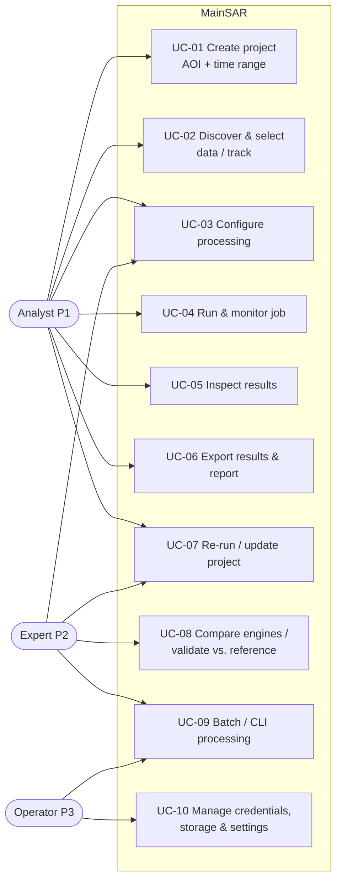
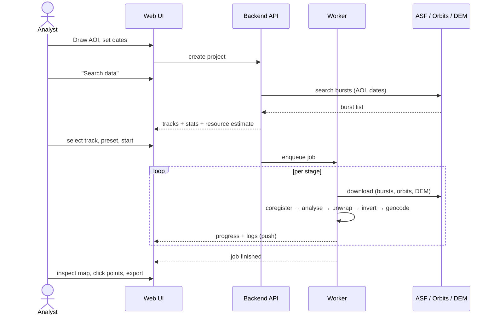

# 03 – Stakeholders & Use Cases

## 1. Stakeholders

| Stakeholder | Interest | Influence | Notes |
|-------------|----------|-----------|-------|
| Product owner (Moritz Schäfer) | Working, efficient application; defines scope and priorities | High | Approves this baseline |
| Students and researchers (end users) | Reliable displacement results with little effort; learning the method | High | Personas below (Q-02) |
| Developers / maintainers | Clean architecture, testability, reproducible environments | Medium | |
| Machine administrator | Installation, updates, MATLAB licence, disk space on the production machine | Medium | One dedicated machine (Q-05) |
| Consumers of results (clients, authorities, engineers) | Understandable maps, reports and uncertainty statements | Medium | Receive exports/reports, do not use the app |
| Data providers (ESA/Copernicus, ASF/NASA, ECMWF) | Terms of use, fair use of APIs | Low (external constraint) | Attribution and rate limits apply |

## 2. Personas

### P1 – "Anna", master's / PhD student (primary)
- Knows GIS (QGIS) and the basics of InSAR from lectures. Knows *what* InSAR delivers but not every StaMPS parameter.
- Works on a thesis or project with a European study area (≤ 100 km², a few years).
- Wants to define an area, press start, and get a map plus time series she can trust.
- Needs good defaults, plain-language parameter explanations, warnings when inputs are unsuitable
  (too few images, poor coherence), and a report she can pass on.

### P2 – "Jonas", researcher / InSAR expert (secondary)
- Has used StaMPS/ISCE/MintPy before. Wants **full parameter control**, access to intermediate products,
  the ability to re-run single stages, and to compare engines.
- Needs an expert mode, access to raw engine parameter files, logs, and the CLI.

### P3 – "Admin", administrator of the production machine (tertiary)
- Installs and updates the software, manages the MATLAB licence, credentials and storage.
- Needs a one-command installer, a self-test, clear resource configuration, health checks and logs.

## 3. Use-case overview

## 4. Use-case specifications

### UC-01 Create project
- **Actor:** Analyst
- **Precondition:** Application running; credentials configured (UC-10).
- **Main flow:**
  1. The user creates a new project and gives it a name.
  2. The user defines the AOI by drawing a rectangle or polygon on the map, **or** by importing
     GeoJSON / KML / KMZ / Shapefile / GeoPackage, **or** by entering a bounding box.
  3. The user picks the start and end date.
  4. The system validates the AOI (valid geometry, area within limits) and the time range (end > start,
     inside the Sentinel-1 archive period).
  5. The system saves the project.
- **Alternative flows:** 2a) An imported file has several features: the user picks one, or the union is used.
  2b) The CRS is not WGS84: the AOI is reprojected automatically.
- **Postcondition:** Project with AOI and time range saved.
- **Requirements:** FR-PRJ-01…05, FR-AOI-01…06

### UC-02 Discover & select data
- **Main flow:**
  1. The system searches the archive for Sentinel-1 IW SLC data intersecting AOI and time range.
  2. The system groups results by **relative orbit and flight direction** and shows per track: number of
     acquisitions, date timeline with gaps, AOI coverage in %, number of bursts needed, estimated download
     volume, disk space and processing time.
  3. The system flags tracks unsuitable for PS (e.g. < 20 acquisitions `[TBC]`, large gaps, partial coverage).
  4. The user selects one track (optionally several, processed as separate stacks).
  5. The user may exclude single acquisitions (e.g. snow-covered winter scenes).
- **Requirements:** FR-DIS-01…07

### UC-03 Configure processing
- **Main flow:**
  1. The user picks the technique (**PSInSAR** or **SBAS**, or both for comparison) and the engine (default per ADR-004) and a **preset** (e.g. *Urban/Infrastructure*,
     *Rural/Landslide*, *Fast preview*).
  2. The system shows the main parameters with plain-language help, defaults and valid ranges.
  3. Expert mode shows all engine parameters ([07](07_processing_parameters.md)).
  4. The system validates the parameters and shows the updated resource estimate.
- **Requirements:** FR-CFG-01…07

### UC-04 Run & monitor job
- **Main flow:**
  1. The user starts processing.
  2. The system runs the stages in order, shows stage and overall progress, ETA, and live logs.
  3. On success, the system notifies the user and opens the results.
- **Alternative / exception flows:**
  - 2a) Download failure → automatic retries with back-off; after N failures the stage fails with a clear message.
  - 2b) User cancels → the running stage stops cleanly and completed stages stay valid.
  - 2c) Crash or reboot → the user resumes, and the job continues from the last completed stage.
  - 2d) Resource limit exceeded (disk) → the job pauses with a clear message before disk is full.
- **Requirements:** FR-JOB-01…08

### UC-05 Inspect results
- **Main flow:**
  1. The system shows the measurement points on a base map, coloured by mean LOS velocity (configurable scale).
  2. The user filters points by quality (temporal coherence), velocity range, or area.
  3. The user clicks a point → the time series plot opens (displacement vs. date, with a fitted trend).
  4. The user selects several points or a polygon → averaged time series.
  5. The system shows QA layers (coherence, PS density, reference point, standard deviation).
- **Requirements:** FR-VIS-01…08

### UC-06 Export results & report
- **Main flow:** The user picks formats (GeoTIFF, GeoPackage, CSV, KMZ, PDF/HTML report). The system writes
  them with metadata (processing parameters, software versions, data sources, sign convention, reference point).
- **Requirements:** FR-EXP-01…08

### UC-07 Re-run / update project
- **Main flow:**
  1. The user changes parameters (e.g. reference point, coherence threshold) → the system re-runs only the
     affected stages (dependency-aware invalidation).
  2. The user extends the time range → the system downloads and processes only new acquisitions
     (incremental with the PSDS engine; full re-analysis for StaMPS, while reusing coregistration).
- **Requirements:** FR-JOB-05, FR-JOB-06, FR-ANA-09

### UC-08 Compare engines / validate
- **Main flow:** The user runs the same project with a second engine or loads a reference (EGMS, GNSS CSV).
  The system shows a comparison: scatter plot, difference map, statistics (bias, RMSE, correlation).
- **Requirements:** FR-VAL-01…04

### UC-09 Batch / CLI processing
- **Main flow:** The expert or operator runs `mainsar run project.yaml` headless. Exit codes, logs and outputs
  are the same as in the UI.
- **Requirements:** FR-CLI-01…04

### UC-10 Manage credentials, storage & settings
- **Main flow:** The user or operator enters and tests credentials (NASA Earthdata, CDSE, CDS/ERA5), sets
  the data/cache directory, resource limits (CPU cores, RAM, disk quota), and the proxy.
- **Requirements:** FR-SET-01…05, NFR-SEC-01…04

## 5. End-to-end user journey (happy path)

