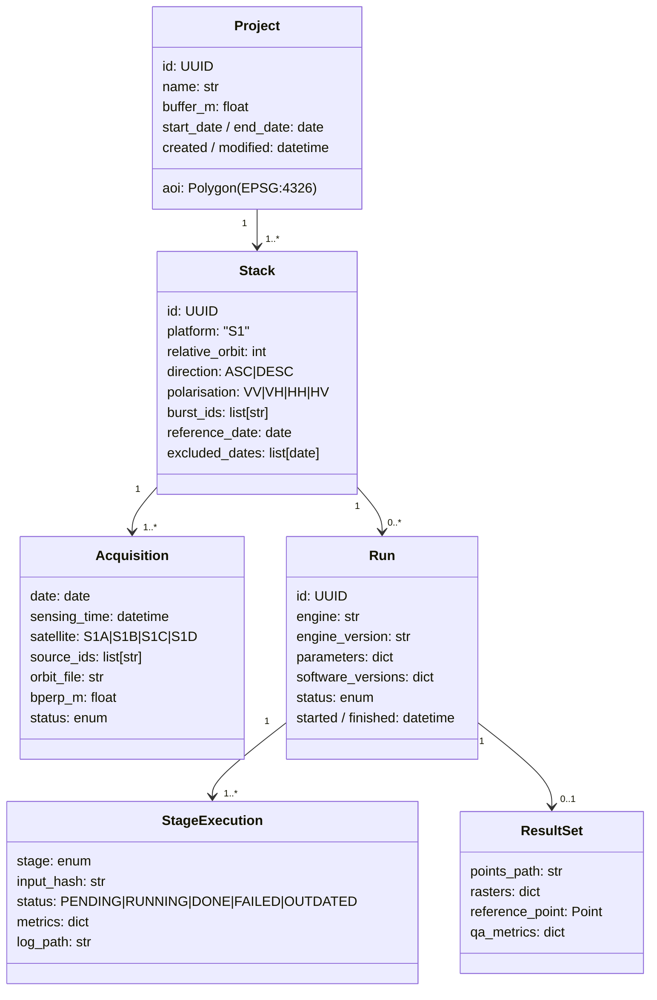

# 06 – Data & Interface Requirements

## 1. External data sources

| ID | Source | Data | Access | Credentials | Notes |
|----|--------|------|--------|-------------|-------|
| DR-01 | **ASF DAAC** (asf_search API) | Sentinel-1 IW SLC scenes and **SLC burst** products, metadata | HTTPS (search API + download) | NASA **Earthdata Login** (free) | Burst products are extracted on demand from full SLCs `[VERIFY S-1: throughput, limits]`. Primary source. |
| DR-02 | **Copernicus Data Space Ecosystem (CDSE)** | Sentinel-1 SLC (fallback), metadata | OData/STAC API, S3 | CDSE account (free) | Fallback when ASF is unavailable; no burst extraction `[VERIFY]` |
| DR-03 | **Precise orbits** (POEORB/RESORB) | Orbit state vectors | via ASF orbit bucket or CDSE (e.g. `sentineleof`) | depends on source `[VERIFY]` | POEORB available ~20 days after acquisition |
| DR-04 | **Copernicus DEM GLO-30** | 30 m DSM, EGM2008 heights | AWS Open Data (public S3, no auth) | none | Needs geoid→ellipsoid conversion for ISCE2 |
| DR-05 | SRTM 1″ (fallback) | 30 m DEM | NASA Earthdata | Earthdata | Coverage 60°N–56°S |
| DR-06 | **ECMWF ERA5** (optional) | Weather model for tropospheric delay | CDS API | CDS account + API key, licence acceptance | Via PyAPS; hourly data |
| DR-07 | GACOS (optional) | Tropospheric delay maps | Manual web request → files | none | User-supplied files |
| DR-08 | **EGMS** (optional) | Reference PS/DS products | EGMS Explorer download (tiles) | EU Login (free) `[VERIFY]` | For validation (FR-VAL-01) |
| DR-09 | GNSS (optional) | Station time series | NGL (tenv3), national networks | none / varies | For validation (FR-VAL-02) |
| DR-10 | ESA burst ID map | Burst footprints and IDs | Static file (GeoPackage/SQLite) | none | For burst selection and coverage |
| DR-11 | Base maps | OSM tiles, satellite imagery | Tile services | Some need API keys | Respect tile usage policies; offline mode shows no base map |

**Requirement DR-12:** Each data source sits behind a *DataSource* adapter (interface: `search`,
`download`, `verify`) so sources can be swapped without core changes (NFR-MAINT-03).

**Requirement DR-13:** The system shall detect and report changes to external APIs (unexpected
response schema) with a specific error instead of failing silently.

## 2. Input data (user-provided)

| ID | Input | Formats | Validation |
|----|-------|---------|------------|
| DR-20 | AOI | GeoJSON, KML/KMZ, Shapefile (zip), GeoPackage, WKT, bbox | Geometry valid; CRS known; area ≤ limit; file ≤ 10 MB |
| DR-21 | Project configuration | YAML (schema-validated) | JSON Schema; semantic checks |
| DR-22 | Local SLC archive (optional) | SAFE zip / directory | Filename pattern + manifest check |
| DR-23 | Custom DEM (optional) | GeoTIFF | CRS, vertical datum stated by the user, AOI coverage |
| DR-24 | Reference data (optional) | EGMS CSV/GPKG, GNSS tenv3/CSV | Schema checks |
| DR-25 | GACOS files (optional) | `.ztd` + `.rsc` | Dates match stack |

## 3. Output data

### 3.1 Product list

| ID | Product | Format | Content |
|----|---------|--------|---------|
| DR-30 | Point dataset | GeoPackage (default), CSV, KMZ, (Shapefile) | One feature per measurement point, see §4.2 |
| DR-31 | Velocity raster | COG GeoTIFF (float32, mm/yr) | Mean LOS velocity, NoData outside valid points |
| DR-32 | Velocity std. dev. raster | COG GeoTIFF | mm/yr |
| DR-33 | Coherence raster | COG GeoTIFF | temporal/ensemble coherence 0–1 |
| DR-34 | Displacement cube | multi-band COG or NetCDF/Zarr (CF conventions) | Cumulative LOS displacement per date (mm) |
| DR-35 | DEM error / height correction | COG GeoTIFF | m |
| DR-36 | Geometry | COG GeoTIFF | Incidence angle, heading, LOS E/N/U |
| DR-37 | QA products | PNG/HTML, JSON | Baseline plot, per-date coherence, QA metrics |
| DR-38 | Report | HTML (+ PDF optional) | See FR-EXP-07 |
| DR-39 | Metadata sidecar | JSON | Config, versions, data IDs, conventions |

### 3.2 Units and conventions (binding)

- Displacement in **mm**, velocity in **mm/yr**, heights in **m**, angles in **degrees**.
- LOS sign: **positive = towards the satellite**.
- Time: dates in ISO 8601 (`YYYY-MM-DD`), UTC; acquisition time stored with the date.
- Reference epoch: first date of the stack (displacement = 0).
- Coordinates: EPSG:4326 for points (lon/lat, 8 decimals); rasters in EPSG:4326 or a user-chosen projected CRS.

## 4. Internal data model

### 4.1 Core entities



**Stage invalidation (DR-40):** each `StageExecution` stores a hash of its inputs (upstream stage hashes +
relevant parameters + tool version). A stage is `OUTDATED` when this hash changes. This implements FR-CFG-05.

### 4.2 Standardised engine result schema (DR-41)

Every analysis engine must deliver this (engine interface FR-ANA-01). Internal format: GeoParquet (points),
COG (rasters), Zarr/NetCDF (displacement cube) (ADR-007). Defined as JSON Schema in `schemas/` (ADR-009).

| Field | Type | Unit | Description |
|-------|------|------|-------------|
| `pid` | string | – | Stable point ID (`<stack>_<row>_<col>`) |
| `row`, `col` | int | px | Position in the radar/crop grid |
| `lon`, `lat` | float64 | deg | Geocoded position (height-corrected) |
| `height` | float32 | m | Ellipsoidal height (DEM + correction) |
| `height_corr` | float32 | m | Estimated DEM error |
| `vel` | float32 | mm/yr | Mean LOS velocity |
| `vel_std` | float32 | mm/yr | Velocity std. dev. |
| `coherence` | float32 | – | Temporal / ensemble coherence |
| `amp_disp` | float32 | – | Amplitude dispersion D_A |
| `type` | enum | – | `PS` / `DS` / `SBAS` (multilooked pixel) |
| `los_e`, `los_n`, `los_u` | float32 | – | LOS unit vector (ground → satellite) |
| `inc_angle` | float32 | deg | Incidence angle |
| `D_YYYYMMDD` … | float32 | mm | Cumulative displacement per date |
| `model_*` | float32 | varies | Optional model parameters (seasonal amplitude, …) |

## 5. Storage layout (DR-42)

```
<data_root>/
├── cache/                         # shared, content-addressed (FR-ACQ-05)
│   ├── s1_bursts/<burst_id>/<date>/...
│   ├── s1_slc/<scene_id>.zip
│   ├── orbits/
│   ├── dem/<source>/<tile>.tif
│   └── weather/era5/
└── projects/<project_id>/
    ├── project.yaml               # single source of truth (FR-PRJ-02)
    ├── state.db                   # SQLite: stacks, runs, stage executions
    └── stacks/<stack_id>/
        ├── inputs/                # symlinks into cache
        ├── preprocessing/         # ISCE2 topsStack work dir (cropped products)
        ├── runs/<run_id>/
        │   ├── engine/            # engine-native work dir (StaMPS/Dolphin)
        │   ├── results/           # standardised result schema
        │   ├── exports/           # user exports
        │   ├── qa/
        │   └── logs/
        └── ...
```

## 6. Interfaces

### 6.1 User interfaces
- **Web UI** (browser), see architecture [08](08_system_architecture.md).
- **CLI** (FR-CLI-*), standalone worker commands (FR-CLI-04).

### 6.2 Internal software interfaces (to be specified in the design phase)

| Interface | Provider → Consumer | Description |
|-----------|---------------------|-------------|
| REST + SSE API (OpenAPI 3) | TS backend → Web UI | Projects, search, jobs, results; push of progress/logs; result files via HTTP range requests |
| **Worker contract** (CLI + JSON request/result + JSON Lines progress) | Python workers → TS core | The only TS/Python boundary, see [08](08_system_architecture.md) §2.2 |
| `DataSource` (Python, inside workers) | Adapters → Acquisition | search/download/verify |
| `Preprocessor` | ISCE2 adapter → Pipeline | Build coregistered stack + geometry |
| `AnalysisEngine` (Python, inside workers) | Dolphin / StaMPS adapters → Pipeline | `prepare()`, `run(stage)`, `collect_results() → ResultSchema`, `parameter_schema()` |
| `Unwrapper` | SNAPHU / spurt / StaMPS-3D | Used by the engines where configurable |
| `Exporter` | GPKG / CSV / COG / KMZ / report | Result schema → files |

### 6.3 External tool interfaces

| Tool | Invocation | Version `[VERIFY]` |
|------|------------|--------------------|
| ISCE2 (topsStack) | Python scripts in the pinned pixi environment | 2.6.x |
| burst2safe | Python package | latest |
| Dolphin | Python API / CLI (`dolphin run config.yaml`) | ≥ 0.x (pinned in S-2) |
| MintPy | Python API / CLI (`smallbaselineApp.py`) with generated template | ≥ 1.6 `[VERIFY S-7]` |
| StaMPS | MATLAB batch (`matlab -batch`) or `octave --eval`; C++ helpers (`mt_prep`, `calamp`, `selpsc_patch`, …) | 4.1b (+ community patches) |
| SNAPHU | CLI | 1.4.2 (installed) / 2.x |
| PyAPS | Python | 0.3.x |
| GDAL/Rasterio/GeoPandas | Python | pinned |
