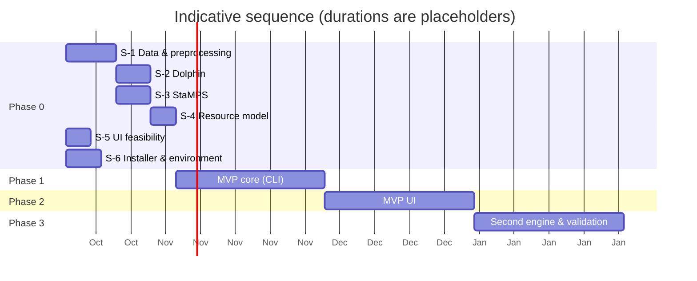

# 11 – Roadmap

Team (Q-14): **Claude implements, the product owner reviews and decides**; work is sequential in small,
reviewable increments (one merge request per requirement group). Sizes are relative (S, M, L); the calendar depends
on review turnaround and on access to the production machine (Q-19).

## Phase 0 – Technical spikes (de-risking), size M–L

Time-boxed experiments on real data. Each spike produces a short report (findings, pinned versions,
measured resources) and updates the requirements (`[VERIFY]`/`[TBC]` items).

| Spike | Question | Exit criterion | Addresses |
|-------|----------|----------------|-----------|
| **S-1** Data & preprocessing | Do asf_search burst search → burst download → burst2safe → ISCE2 topsStack (NESD) → crop work end-to-end on DS-CI? Which credentials are really needed (orbits)? | Coregistered, cropped stack + geometry from bursts only; volumes and times measured | A-02, A-03, R-03, ADR-003 |
| **S-2** Dolphin on ISCE2 stack | Can Dolphin consume the S-1 stack (radar coords)? Quality of the PS/DS output, runtime and RAM on HW-DEV (DS-CI); how to geocode. | Velocity map + time series from DS-CI; plausibility; resource numbers | A-04, ADR-004 |
| **S-3** StaMPS runtime | Does StaMPS 4.1b (+ community fixes) run steps 1–8 on the S-1 stack with MATLAB R2026a? Which toolboxes are needed? (Octave deferred, Q-20.) | Velocity map from DS-CI with MATLAB; list of needed patches and toolboxes | A-05, R-02 |
| **S-4** Resource model | Measure CPU/RAM/disk/time per stage vs. stack size (dates × pixels) on HW-DEV with DS-CI and on HW-PROD (as soon as available). | Estimator formulas with ±30 % accuracy; confirmed NFR-PERF targets | FR-DIS-03, NFR-PERF-*, R-01, R-09 |
| **S-5** UI feasibility (small) | deck.gl rendering of 1 M points from GeoParquet/Arrow in the browser; form generation from JSON Schema; COG rendering client-side. | Prototype meets NFR-PERF-04 | ADR-002, ADR-009 |
| **S-6** Installer & environment | Can one pixi lockfile provide ISCE2, Dolphin, SNAPHU, Node.js and compilers for StaMPS/triangle on Ubuntu 24.04 and Manjaro? MATLAB detection + `matlab -batch` licence check. | Working `install.sh` prototype on a fresh VM; list of components built from source | FR-INS-*, A-09, R-04 |
| **S-7** SBAS with MintPy | Does ISCE2 topsStack (interferogram workflow) → MintPy `smallbaselineApp` run on DS-CI, and how are its outputs mapped to the result schema? | Velocity map + time series from DS-CI; list of parameters | FR-ANA-12, R-16 |

## Phase 1 – MVP core (headless), size L

Goal: **reference scenario runs end-to-end from the CLI** with one engine.

- JSON Schemas + code generation (TS/Python); worker contract.
- TS core: project/config handling, SQLite state DB, stage orchestrator with hashing/resume, process supervision.
- Installer (FR-INS-01…03, 05, 06, 09, 11, 12) and `mainsar doctor`.
- Data: search, estimate, burst download, orbits, DEM, cache.
- Preprocessing: ISCE2 adapter, crop, geometry.
- Engine #1 (per Q-01) + result schema + reference point + geocoding.
- Exports: GeoPackage, CSV, COG, metadata sidecar.
- CLI: `init/search/estimate/run/status/resume/export`.
- QA metrics, structured logging, CI (incl. fresh-VM install test).
- Covers all *Must* requirements except UI (FR-AOI-01, FR-VIS-*).

## Phase 2 – MVP UI, size L

Goal: **persona P1 completes the workflow in the browser**.

- Fastify API + SSE, job scheduling.
- Web UI: project wizard with the **in-app map selector** (click a polygon or drag a rectangle on the map, edit vertices, live area; FR-AOI-01) and file import, dates, data discovery view (tracks, timeline, estimate, warnings),
  schema-generated parameter forms with presets, job monitor with logs, result viewer (map + time series + filters + QA layers), export dialog.
- **→ MVP release (v0.1)** after acceptance tests AT-01…AT-08, AT-10…AT-14.

## Phase 3 – SBAS, second PS engine & validation, size L

- **SBAS engine (MintPy)** incl. interferogram network (FR-PRE-09, FR-ANA-12).
- StaMPS-PS engine (MATLAB).
- Validation tools: EGMS/GNSS import and comparison (FR-VAL-*), AT-09.
- ERA5 correction, seasonal model, processing report (HTML), standalone web viewer export (FR-EXP-08).
- Asc/desc decomposition into vertical/east-west (FR-ANA-08).
- Incremental updates (FR-ANA-09, FR-PRE-07).
- **→ v1.0**

## Phase 4 – Extensions (prioritise after v1.0)

- Multi-track projects beyond asc/desc pairs.
- Installer extras: MATLAB installation assistance (FR-INS-04), upgrade/rollback (FR-INS-08), systemd service (FR-INS-07).
- Further engines/modes (SARvey, StaMPS SBAS/merged), NISAR support.
- PDF report, profile tool, animation.

## MVP definition (summary)

| Included | Excluded (later) |
|----------|------------------|
| Sentinel-1, 1 track per run, VV | Multi-track decomposition |
| AOI draw/import, time range | Profile tool, animation |
| Burst download, orbits, DEM, cache | Local SLC archive import (S) |
| ISCE2 coregistration + crop | Incremental coregistration |
| One engine: Dolphin PSInSAR (Q-01) | SBAS (MintPy) and StaMPS engines, comparisons (Phase 3) |
| DEM error, engine-internal atmospheric filtering | ERA5/GACOS |
| Reference point (auto/manual), linear velocity | Seasonal/step models |
| GPKG, CSV, COG, **KMZ** exports + metadata | Shapefile, PDF report, standalone web viewer (Phase 3) |
| Map viewer + time series + filters + QA layers | EGMS/GNSS validation tools |
| Background jobs, progress, cancel, resume | Upgrade/rollback, systemd service |
| One-command installer + self-test (all dependencies; MATLAB detection) | MATLAB installation assistance |
| CLI + YAML config | Standalone worker docs (S) |
